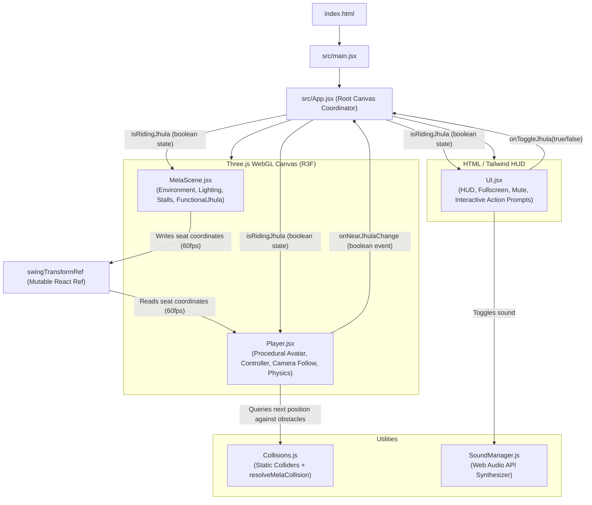

# Diwali Mela 3D — Complete Architecture & Structure Audit

> **Document Purpose**: Comprehensive system documentation and codebase audit designed for AI agents and developers to immediately understand, maintain, debug, and extend this project without loss of context.
> **Repository**: [https://github.com/RaizianOfficial/diwali.git](https://github.com/RaizianOfficial/diwali.git)  
> **Branch**: `main`  
> **Last Updated**: November 2026 (Audit & Camera Stabilization Release)

---

## 1. Executive Summary & Project Vision

**Diwali Mela 3D** is an interactive, browser-based 3D festive experience built with **React Three Fiber (Three.js)** and **Vite**. 
The player explores a lively Indian Diwali fairground (*mela*) complete with:
- A traditional Indian avatar dressed in a golden kurta and pyjama holding a diya
- Traditional festive stalls (Mithai, Diyas, Kandil, Puja Samagri)
- A central multi-tiered stone Deepstambha surrounded by floral Rangoli mandalas
- Marigold flower garlands, fairy string lights, starry night sky, and deep warm lanterns
- A fully functional, physics-animated **Interactive Swing (*Jhula*)** that the player can walk up to, mount, swing on, and jump off
- Real-time **solid object collision detection** with natural wall-sliding (no clipping through buildings or pillars)
- A smooth, jitter-free **360° Third-Person Orbit Camera** with mouse drag and scroll wheel zoom

The project is designed to be **lightweight**, **zero-asset-load** (fast initial render with procedural Three.js geometries), and run at a rock-solid **60 FPS** on both low-power laptops and high-refresh PC screens.

---

## 2. Technology Stack & Dependencies

| Layer | Package / Tool | Version | Notes / Critical Compatibility Rules |
|---|---|---|---|
| **Runtime & Bundler** | `vite` | `^5.4.2` | Fast HMR, production chunking |
| **Framework** | `react`, `react-dom` | `^18.2.0` | React 18 concurrent mode |
| **3D Engine** | `three` | `^0.160.0` | ⚠️ Pinned to 0.160.0 for library stability |
| **R3F Ecosystem** | `@react-three/fiber` | `^8.15.16` | React reconciler for Three.js |
| | `@react-three/drei` | `^9.96.1` | Helpers (`Stars`, `useGLTF`, `useAnimations`) |
| | `@react-three/postprocessing` | `^2.16.2` | Available in dependencies if bloom is enabled |
| | `postprocessing` | `6.36.4` | ⚠️ Pinned to 6.36.4 (incompatible with Three >= 0.171) |
| **Styling** | `tailwindcss` | `^3.4.17` | ⚠️ Pinned to Tailwind v3 (v4 requires different config) |
| | `lucide-react` | `^0.312.0` | Minimal festive HUD icons |
| **Audio** | Procedural Web Audio API | Native | No external .mp3 downloads required |
| **Backend & Cloud (Dormant)** | `firebase` | `^10.8.0` | Setup for Firestore leaderboard |
| **Payments (Dormant)** | Razorpay SDK | Loaded via script | In `index.html` for contribution modals |

---

## 3. Repository File Structure

```
DIWALI/
├── index.html                    # HTML entry, Google Fonts (Cinzel Decorative, Poppins), Razorpay script
├── package.json                  # Dependencies and scripts (dev, build, preview)
├── vite.config.js                # Vite configuration with React plugin
├── tailwind.config.js            # Festive colors (deep-gold, crimson, diya-orange) & glow utilities
├── postcss.config.js             # PostCSS plugins (Tailwind, Autoprefixer)
├── .env.example                  # Environment variables template for Firebase & Razorpay
├── PROJECT_STRUCTURE_AUDIT.md    # 👈 THIS COMPREHENSIVE AUDIT FILE
├── public/
│   ├── manifest.json             # PWA web manifest
│   ├── icon.svg                  # Diya SVG logo
│   ├── sw.js                     # Service worker
│   └── models/                   # [LEGACY / UNUSED] .glb models from earlier iteration
└── src/
    ├── main.jsx                  # React DOM root render
    ├── App.jsx                   # [ACTIVE] Main coordinator: Canvas, State, and Ref pipelines
    ├── index.css                 # Tailwind base styles, custom scrollbars, gold glow animations
    ├── firebase.js               # [DORMANT] Firebase initialization & Firestore leaderboard subscriber
    ├── components/
    │   ├── MelaScene.jsx         # [ACTIVE] Full 3D environment, lighting, stalls, deepstambha, jhula
    │   ├── Player.jsx            # [ACTIVE] Character mesh, WASD/Sprint/Jump, Orbit Camera, Collisions
    │   ├── UI.jsx                # [ACTIVE] PC HUD, Fullscreen toggle, Audio toggle, Swing action prompt
    │   ├── Billboard.jsx         # [DORMANT] 3D CanvasTexture leaderboard plane (Firestore data)
    │   ├── Firecracker.jsx       # [DORMANT] InstancedMesh particle fireworks (Phuljhadi, Anaar, Chakri, Rocket)
    │   ├── House.jsx             # [LEGACY] GLTF loader wrapper for house model
    │   ├── NPC.jsx               # [LEGACY] GLTF loader wrapper with skeletal animations
    │   ├── Jhula.jsx             # [LEGACY] Old static GLTF jhula wrapper (replaced by FunctionalJhula)
    │   ├── Joystick.jsx          # [DORMANT] Mobile virtual touch joystick
    │   ├── TouchCameraZone.jsx   # [DORMANT] Mobile touch swipe camera control
    │   ├── Props.jsx             # [LEGACY] Primitive props collection
    │   └── Scene.jsx             # [LEGACY] Early prototype scene
    └── utils/
        ├── Collisions.js         # [ACTIVE] Collider registry + 2D circle & AABB wall-sliding solver
        └── SoundManager.js       # [ACTIVE] Web Audio API procedural sound generator
```

---

## 4. Active Component Architecture & Data Flow



### High-Performance 60 FPS Rule
To prevent React virtual DOM thrashing:
- **Never call `useState` every frame inside `useFrame`**.
- Transform data between `FunctionalJhula` and `Player` passes through `swingTransformRef` (a shared mutable React ref).
- React state (`isRidingJhula`, `isNearJhula`) is only changed on **discrete user events** (mounting the swing with `[E]`, jumping off with `[Space]`, or walking across the 2.8m radius boundary).

---

## 5. Subsystem Deep-Dive

### A. Camera Follow & Screen Shake Elimination (`src/components/Player.jsx`)
In early versions, players experienced jarring camera shake / micro-stutters when walking. 

**Root Causes Identified & Fixed**:
1. **Unsynchronized LookAt vs Positional Lag**:
   - `camera.position` was being lerped by a fixed `0.1`, lagging behind the player.
   - However, `camera.lookAt` was instantly snapping to the unlagged, raw character coordinates every frame.
   - As the player moved forward step-by-step, the angle between the lagging camera and jumping lookAt vector fluctuated, causing high-frequency rotational jitter.
2. **Frame-Rate Dependency**:
   - Fixed scalar lerp factors (e.g. `0.1`) behave inconsistently across 60Hz, 120Hz, and 144Hz monitors.
3. **Upper Body Bobbing**:
   - The walk-cycle bounce amplitude on the character torso was overly aggressive.

**The Solution**:
```javascript
// 1. Maintain a dedicated smoothed anchor target
const targetLookY = position.current.y + 1.25;
const lookAlpha = 1 - Math.exp(-14 * delta); // Framerate-independent damping
cameraTarget.current.x = THREE.MathUtils.lerp(cameraTarget.current.x, position.current.x, lookAlpha);
cameraTarget.current.y = THREE.MathUtils.lerp(cameraTarget.current.y, targetLookY, lookAlpha);
cameraTarget.current.z = THREE.MathUtils.lerp(cameraTarget.current.z, position.current.z, lookAlpha);

// 2. Compute desired camera offset anchored directly to smoothed target
const offsetX = Math.sin(yaw) * Math.cos(pitch) * dist;
const offsetY = Math.sin(pitch) * dist;
const offsetZ = Math.cos(yaw) * Math.cos(pitch) * dist;

const desiredCameraPos = new THREE.Vector3(
  cameraTarget.current.x + offsetX,
  cameraTarget.current.y + offsetY,
  cameraTarget.current.z + offsetZ
);

// 3. Move camera smoothly and point at the exact same anchor
const camAlpha = 1 - Math.exp(-14 * delta);
camera.position.lerp(desiredCameraPos, camAlpha);
camera.lookAt(cameraTarget.current);
```
Both camera position and camera orientation now share the exact same smoothed coordinate system, creating a butter-smooth 3rd person follow experience.

---

### B. Solid Object Collision System (`src/utils/Collisions.js`)
Rather than relying on heavy physics engines (Ammo.js or Rapier) which increase bundle size and cause physics step tunneling, the mela uses an analytical **2D Wall-Sliding Collision Solver**:
- **Collider Types**:
  - `cylinder`: Central Deepstambha base ($x=0, z=0, r=2.85$)
  - `box`: Stalls (Mithai, Diya, Kandil, Puja), Entrance Gate pillars, and Jhula A-frame wooden posts
- **Wall-Sliding Mechanics**:
  - The solver checks the candidate position `(nextX, nextZ)` with character radius `0.44m`.
  - For boxes, it computes penetration depths on both the X and Z axes, pushing the character out along the axis of minimum penetration.
  - This allows the player to slide smoothly along stall counters and fence walls without catching or jittering.

---

### C. Interactive Functional Jhula (`src/components/MelaScene.jsx` & `Player.jsx`)
- **Physics**: Real harmonic pendulum motion:
  $$\theta(t) = A \cdot \sin(\omega \cdot t)$$
  Where $A = 0.28\text{ rad}$ (idle) or $0.44\text{ rad}$ (when player rides), and $\omega = 1.9\text{ rad/s}$.
- **Seat Kinematics**:
  $$Y_{\text{seat}} = Y_{\text{pivot}} - L \cdot \cos(\theta), \quad Z_{\text{seat}} = Z_{\text{pivot}} + L \cdot \sin(\theta)$$
  With $L = 2.5\text{m}$ (brass chains) and $Y_{\text{pivot}} = 3.6\text{m}$.
- **Riding State Transition**:
  1. Walking near the jhula ($d < 2.8\text{m}$) triggers the UI prompt.
  2. Pressing `[E]` sets `isRidingJhula = true`.
  3. `Player.jsx` enters **CASE A**: snaps character root to seat coordinates, tilts body with pendulum angle, angles legs forward with simulated inertia, and locks hands to brass chains.
  4. Pressing `[E]` or `[Space]` dismounts the player safely in front of the swing with an optional jump boost.

---

### D. Procedural Festive Indian Character
Constructed entirely using native Three.js primitives to guarantee instant load times without network asset latency:
- **Head & Turban (*Pagri*)**: Maroon & gold silk turban wrapped with a golden jewel (*kalgi*)
- **Torso**: Traditional golden silk Kurta with embroidered neck border
- **Waist Sash & Dhoti**: Festive vermilion red sash (*patka*) and cream silk churidar
- **Arms & Diya**: Articulated arms holding an authentic brass earthen Diya with an animated flickering flame emitting warm dynamic light
- **Skeletal Kinematics**: Sine-wave limb swinging with counter-balanced arm swing and subtle torso leaning based on movement velocity

---

## 6. Dormant Features & How to Reactivate

The codebase already contains fully written components from previous iterations. Here is how to reactivate them:

### 1. Firecrackers & Inventory UI
- **Components**: `src/components/Firecracker.jsx`, `src/utils/SoundManager.js`
- **Capabilities**: Phuljhadi (sparkler), Anaar (fountain), Chakri (ground spinner), and Rocket.
- **How to activate**: Import `<FirecrackerManager />` into `App.jsx`, add an inventory tray in `UI.jsx`, and on ground click raycast, spawn the firecracker at the clicked coordinate.

### 2. Firestore Leaderboard & 3D Billboard
- **Components**: `src/components/Billboard.jsx`, `src/firebase.js`
- **Capabilities**: Queries Firestore collection `donations` (Top 10 contributors), draws live names and amounts onto an HTML5 Canvas, renders dynamic `CanvasTexture` on a 3D wooden billboard in the mela.
- **How to activate**: Fill in `.env` with Firebase project credentials and render `<Billboard position={[0, 0, -18]} />` in `MelaScene.jsx`.

### 3. Mobile Joystick & Touch Camera Zone
- **Components**: `src/components/Joystick.jsx`, `src/components/TouchCameraZone.jsx`
- **Capabilities**: On-screen virtual joystick sending `(x, y)` move vectors, and swipe touchpad on the right half of the screen for camera yaw/pitch.
- **How to activate**: Import into `App.jsx` when `('ontouchstart' in window || navigator.maxTouchPoints > 0)`.

---

## 7. Development & Verification Guide

### Quick Start
```bash
# 1. Install dependencies
npm install

# 2. Run local development server
npm run dev

# 3. Build for production
npm run build

# 4. Preview production build locally
npm run preview
```

### Verification Checklist
- [x] Character movement: `W`, `A`, `S`, `D` moves relative to camera angle
- [x] Sprinting: `Shift` increases speed from 5.0 to 8.5 m/s
- [x] Jumping: `Space` triggers gravity-based parabolic jump
- [x] Camera Orbit: Mouse drag rotates view 360° horizontally and clamps vertically
- [x] Camera Zoom: Mouse scroll wheel zooms in/out smoothly between 3.2m and 11.0m
- [x] Camera Stability: No screen shake or micro-stutters during walking, sprinting, or turning
- [x] Collisions: Character slides against stalls, entrance pillars, and deepstambha without passing through
- [x] Jhula Interaction: Press `[E]` near swing to mount; swing sways naturally; press `[E]` or `[Space]` to dismount
- [x] Zero 60Hz React Re-render thrashing: App state updates only on discrete events
- [x] Production Build: `npm run build` succeeds with 0 errors
